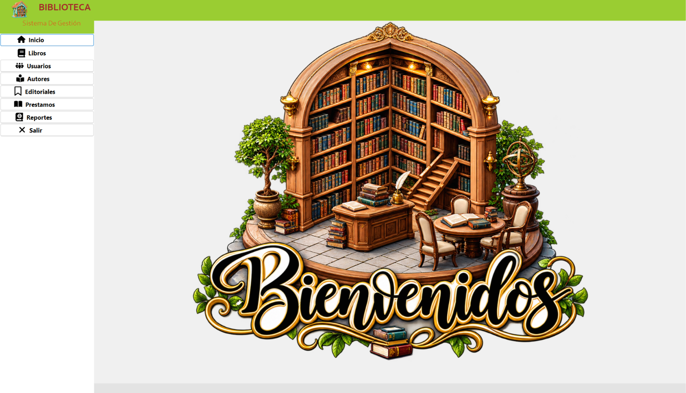
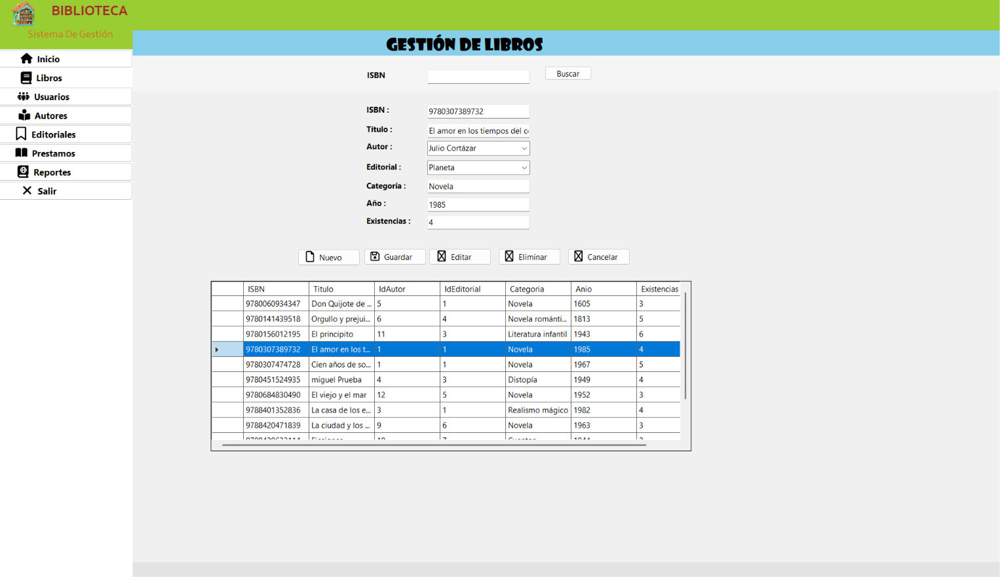
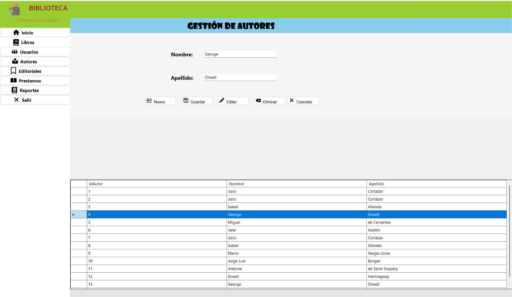
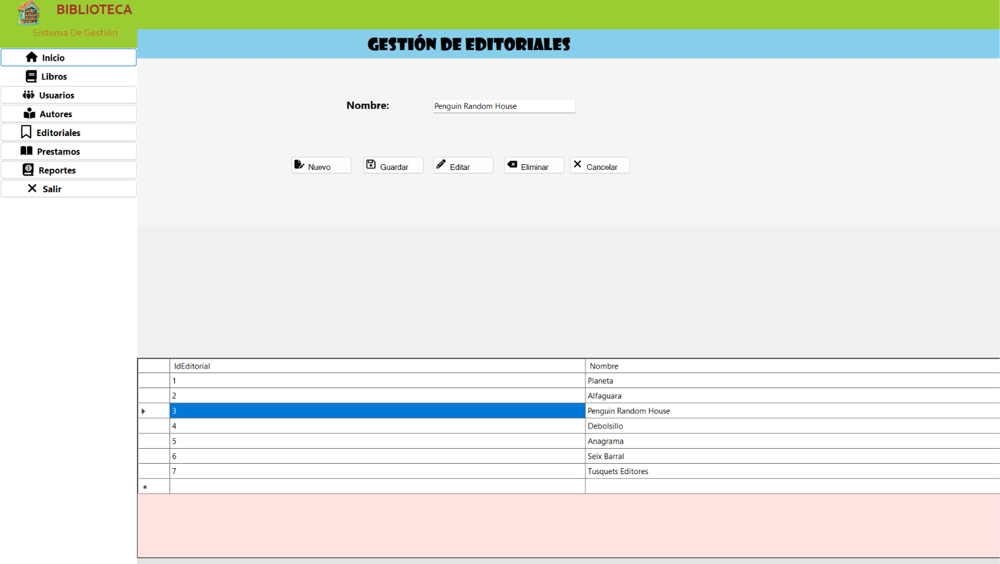
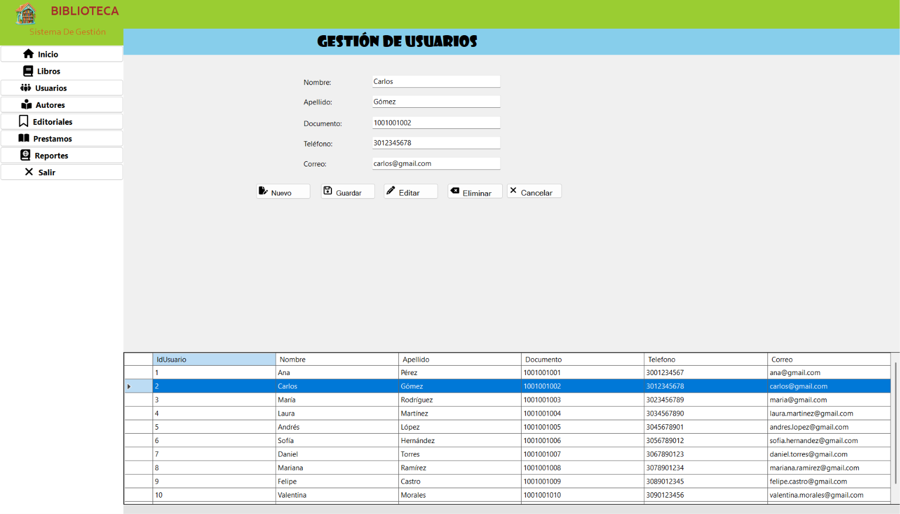
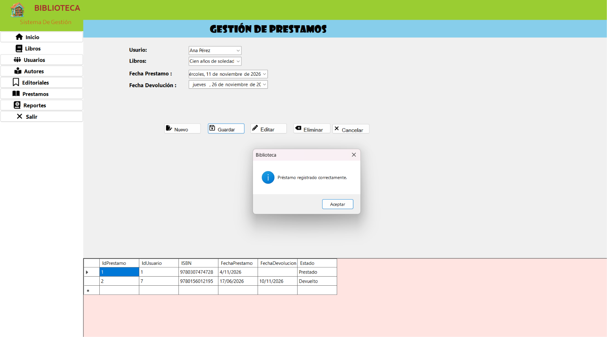
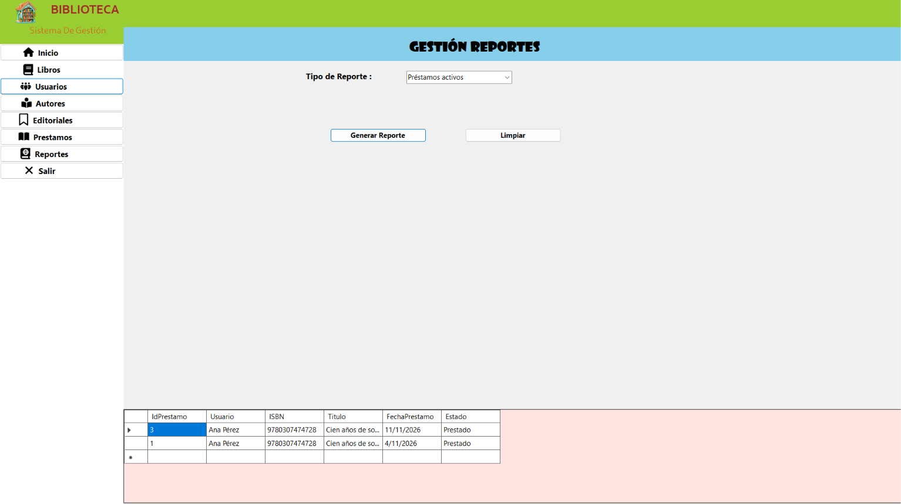
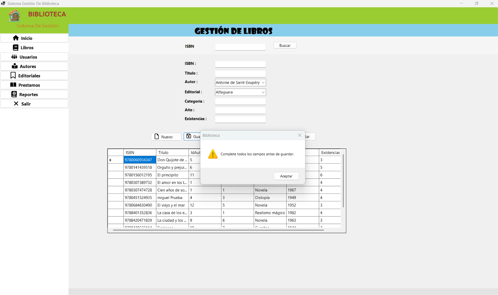

# ACA -- Programación Avanzada

# Sistema de Gestión de Biblioteca

------------------------------------------------------------------------

## PORTADA

### COORPORACIÓN UNIFICADA NACIONAL DE EDUCACIÓN SUPERIOR 

### INGENIERIA DE SISTEMAS / 54469

### ACA -- Programación Avanzada

### Sistema de Gestión de Biblioteca

**Presentado por:**
### Daniel Tovar Avila

**Docente:**
### VERONICA CASTRO MUNAR

**Fecha:**
### Bogotá D.C, 08, 11 , 2026

------------------------------------------------------------------------
------------------------------------------------------------------------

## CONTRAPORTADA

 ### COORPORACIÓN UNIFICADA NACIONAL DE EDUCACIÓN SUPERIOR  

### INGENIERIA DE SISTEMAS / 54469

### ACA -- Programación Avanzada

### Sistema de Gestión de Biblioteca

**Presentado por:**
### Daniel Tovar Avila

**Docente:**
### VERONICA CASTRO MUNAR

**Fecha:**
### Bogotá D.C, 08, 11 , 2026

------------------------------------------------------------------------
------------------------------------------------------------------------

# TABLA DE CONTENIDO


1.  Introducción
2.  Objetivos
    -   2.1 Objetivo general
    -   2.2 Objetivos específicos
3.  Planteamiento del problema
4.  Análisis de requerimientos
5.  Casos de uso
6.  Diagrama de clases
7.  Modelo entidad-relación
8.  Diccionario de datos
9.  Arquitectura del sistema
10. Explicación de los módulos desarrollados
11. Capturas de pantalla del sistema
12. Pruebas de funcionamiento
13. Conclusiones


------------------------------------------------------------------------

# 1. INTRODUCCIÓN

Las bibliotecas desempeñan un papel fundamental en la gestión y acceso a la información; sin embargo, muchos de sus procesos aún se realizan de forma manual, lo que puede generar demoras, errores y dificultades en el control de préstamos y registros. Ante esta necesidad, surge la implementación de un aplicativo de escritorio para la gestión bibliotecaria, diseñado para optimizar la administración de libros, usuarios y préstamos.

Este proyecto tiene como objetivo desarrollar una herramienta informática que facilite la organización de la información, mejore la eficiencia de los procesos y brinde un acceso rápido y seguro a los datos. De esta manera, se busca contribuir a una gestión más efectiva de la biblioteca, fortaleciendo la calidad del servicio ofrecido a los usuarios.


------------------------------------------------------------------------

# 2. OBJETIVOS

## 2.1 Objetivo general

Desarrollar e implementar un aplicativo de escritorio para la gestión integral de una biblioteca, con el fin de optimizar el control de libros, usuarios y préstamos, mejorando la organización y el acceso a la información.

## 2.2 Objetivos específicos

-   Diseñar una base de datos que permita almacenar y administrar de manera segura la información de libros, usuarios y préstamos.
-   Desarrollar módulos para el registro, actualización, consulta y eliminación de información bibliográfica.
-   Diseñar e implementar una base de datos relacional en SQL Server.
-   Implementar un sistema de gestión de préstamos y devoluciones que facilite el seguimiento de los materiales prestados.
-   Mejorar la organización y disponibilidad de la información mediante herramientas de búsqueda rápida y generación de reportes.
-   Evaluar el funcionamiento del aplicativo para garantizar su correcto desempeño, usabilidad y cumplimiento de los requisitos establecidos por la biblioteca.


------------------------------------------------------------------------

# 3. PLANTEAMIENTO DEL PROBLEMA

## 3.1 Descripción del problema

En muchas bibliotecas, la gestión de la información relacionada con libros, autores, categorías, usuarios y préstamos se realiza de manera manual o mediante herramientas poco integradas, lo que dificulta la administración eficiente de los recursos bibliográficos. Esta situación puede ocasionar pérdida de información, errores en los registros, demoras en la atención a los usuarios y dificultades para controlar la disponibilidad de los libros.

Además, la falta de un sistema centralizado limita el seguimiento de los préstamos y devoluciones, dificultando la consulta del historial de movimientos y la identificación de los materiales que se encuentran prestados o disponibles. Del mismo modo, la administración de autores y categorías puede volverse compleja a medida que aumenta la cantidad de información almacenada.

## 3.2 Justificación
Ante esta problemática, surge la necesidad de implementar un aplicativo de escritorio que permita gestionar de manera eficiente los libros, autores, categorías y usuarios de la biblioteca. Asimismo, el sistema facilitará el registro de préstamos y devoluciones, la consulta de la disponibilidad de los ejemplares y el acceso al historial de préstamos, contribuyendo a mejorar la organización de la información, optimizar los procesos administrativos y brindar un servicio más rápido y confiable a los usuarios de la biblioteca.


## 3.3 Alcance

El sistema permitirá:

-   Gestionar libros.
-   Gestionar autores.
-   Gestionar categorías.
-   Gestionar usuarios.
-   Registrar préstamos.
-   Registrar devoluciones.
-   Consultar disponibilidad.
-   Consultar historial de préstamos.
-   Reporte de libros prestados.
-   Reporte de libros más solicitados.
-   Reporte de usuarios con más préstamos.
-   Reporte de préstamos por fechas.

### Fuera del alcance

Indicar las funcionalidades que **no** forman parte de esta versión del
proyecto.

-   Gestión de multas o sanciones por retraso en la devolución de libros.
-   Envío automático de notificaciones o recordatorios por correo electrónico.
-   Reservación de libros por parte de los usuarios.
-   Consulta del catálogo en línea a través de una aplicación web o móvil.
-   Integración con sistemas externos o plataformas bibliotecarias.

------------------------------------------------------------------------

# 4. ANÁLISIS DE REQUERIMIENTOS

## 4.1 Descripción general

El aplicativo de escritorio para la gestión de bibliotecas es una herramienta desarrollada para facilitar la administración y organización de la información bibliográfica. Permite gestionar libros, autores, categorías y usuarios, así como registrar préstamos y devoluciones de manera eficiente.

Además, el sistema ofrece consultas sobre la disponibilidad de los libros y el historial de préstamos, contribuyendo a mejorar el control de los recursos bibliográficos y agilizar los procesos internos de la biblioteca.

## 4.2 Actores del sistema

  -----------------------------------------------------------------------
  Actor                               Descripción
  ----------------------------------- -----------------------------------
  Bibliotecario / Administrador      
   \[
-   Gestionar libros.
-   Gestionar autores.
-   Gestionar categorías.
-   Gestionar usuarios.
-   Registrar préstamos.
-   Registrar devoluciones.
-   Consultar disponibilidad.
-   Consultar historial de préstamos.
-   Reporte de libros prestados.
-   Reporte de libros más solicitados.
-   Reporte de usuarios con más préstamos.
-   Reporte de préstamos por fechas..\]

  
## 4.3 Requerimientos funcionales

  -----------------------------------------------------------------------
  Código                  Requerimiento           Descripción
  ----------------------- ----------------------- -----------------------
  RF01                    Gestionar libros        Registrar, consultar,
                                                  actualizar, eliminar y
                                                  buscar libros.

  RF02                    Gestionar autores       Registrar, consultar,
                                                  actualizar y eliminar
                                                  autores.

  RF03                    Gestionar categorías    Registrar, consultar,
                                                  actualizar y eliminar
                                                  categorías.

  RF04                    Gestionar usuarios      Registrar, consultar,
                                                  actualizar y eliminar
                                                  usuarios.

  RF05                    Registrar préstamos     Registrar préstamos y
                                                  actualizar la
                                                  disponibilidad de los
                                                  libros.

  RF06                    Registrar devoluciones  Registrar devoluciones,
                                                  calcular retrasos y
                                                  multa cuando aplique.

  RF07                    Realizar consultas      Consultar libros
                                                  disponibles, libros
                                                  prestados, historial y
                                                  usuarios con préstamos
                                                  activos.

  RF08                    Realiza reportes        Reporte de libros prestados
                                                  reporte libros más solicitados,
                                                  reporte de usuarios con más préstamos, reporte de préstamos por fechas.
  -----------------------------------------------------------------------


## 4.4 Requerimientos no funcionales

  -----------------------------------------------------------------------
  Código                  Requerimiento           Descripción
  ----------------------- ----------------------- -----------------------
  RNF01                   Usabilidad              La interfaz debe ser
                                                  clara, sencilla y fácil
                                                  de utilizar.

  RNF02                   Validación              El sistema debe validar
                                                  la información
                                                  ingresada por el
                                                  usuario.

  RNF03                   Mantenibilidad          El código debe estar
                                                  organizado y
                                                  documentado.

  RNF04                   Arquitectura            El sistema debe
                                                  utilizar una
                                                  arquitectura por capas.

  RNF05                   Manejo de excepciones   Las operaciones deben
                                                  manejar errores de
                                                  forma controlada.

  RNF06                   Integridad de datos     La información debe
                                                  mantenerse consistente
                                                  en la base de datos.

  RNF07                   Consultas               Las consultas a la base
                          parametrizadas          de datos deben utilizar
                                                  parámetros.

  -----------------------------------------------------------------------

## 4.5 Reglas de negocio

### RN01 -- Código único del libro

No se permitirá registrar dos libros con el mismo código.

### RN02 -- Datos obligatorios

No se permitirá almacenar registros con campos obligatorios vacíos.

### RN03 -- Usuario existente

No se podrá registrar un préstamo para un usuario inexistente.

### RN04 -- Libro existente

No se podrá registrar un préstamo para un libro inexistente.

### RN05 -- Disponibilidad

No se podrá prestar un libro cuando no existan ejemplares disponibles.

### RN06 -- Actualización de disponibilidad

Al registrar un préstamo, la disponibilidad del libro deberá
actualizarse.

### RN07 -- Devolución

Al registrar una devolución, la disponibilidad deberá actualizarse
nuevamente.

### RN08 -- Multa

La multa se calculará únicamente cuando exista retraso en la devolución.

### RN09 -- Datos validos 

Los datos deben de ser validos según requerimiento.

------------------------------------------------------------------------

# 5. CASOS DE USO

## 5.1 Descripción

Describir cómo interactúan los actores con las funcionalidades
principales del sistema.

## 5.2 Diagrama de casos de uso


## 5.3 Descripción de casos de uso

### CU01 -- Gestionar libros

**Actor principal:** Bibliotecario / Administrador

**Descripción:** Permite registrar, consultar, actualizar, eliminar y
buscar libros.

**Precondiciones:** 
- El usuario debe haber iniciado sesión en el sistema.
El usuario debe contar con permisos para gestionar libros.
La base de datos debe estar disponible.

**Flujo principal:** 
1. El actor ingresa al módulo de libros. 
2. El sistema muestra los libros registrados. 
3. El actor selecciona la operación que desea realizar. 
4. El sistema procesa la solicitud. 
5. El sistema muestra el resultado.

**Flujos alternativos:** 
- Si los datos ingresados son incompletos o incorrectos, el sistema muestra un mensaje de error y solicita la corrección.
- Si el libro buscado no existe, el sistema informa que no se encontraron resultados.
- Si ocurre un error durante el almacenamiento o actualización de la información, el sistema notifica al usuario.
- Si se intenta eliminar un libro que tiene préstamos activos, el sistema impide la eliminación y muestra una advertencia.

**Postcondiciones:** 
- El libro queda registrado, actualizado o eliminado según la operación seleccionada.
- La información almacenada en la base de datos se mantiene actualizada.
- El sistema refleja los cambios realizados en el catálogo de libros.

------------------------------------------------------------------------

### CU02 -- Registrar préstamo

**Actor principal:** Bibliotecario / Administrador

**Descripción:** Permite registrar el préstamo de uno o varios libros a
un usuario.

**Precondiciones:** 
- El usuario debe existir. 
- El libro debe existir. 
- Debe existir disponibilidad.

**Flujo principal:** 
1. Seleccionar usuario. 
2. Seleccionar libro. 
3. Verificar disponibilidad. 
4. Registrar préstamo. 
5. Actualizar disponibilidad. 
6. Mostrar confirmación.

**Flujos alternativos:** 
- Usuario inexistente. 
- Libro inexistente. 
- Libro sin disponibilidad. 
- Si ocurre un error al guardar la información


**Postcondiciones:** 
- El préstamo queda registrado en la base de datos.
- La disponibilidad de los libros prestados se actualiza.
- El historial de préstamos del usuario queda actualizado.
- El estado de los libros cambia a "Prestado".

------------------------------------------------------------------------

### CU03 -- Registrar devolución

**Actor principal:** Bibliotecario / Administrador

**Descripción:** Permite registrar la devolución de un libro prestado.

**Precondiciones:** 
- Debe existir un préstamo activo.

**Flujo principal:** 
1. Seleccionar el préstamo. 
2. Registrar ladevolución. 
3. Calcular días de retraso. 
4. Calcular multa cuando corresponda. 
5. Actualizar disponibilidad.
6. Actualizar el estado del préstamo. 
7. Mostrar confirmación.

**Flujos alternativos:** 
- Si el préstamo seleccionado no existe, el sistema muestra un mensaje de error.
- Si el préstamo ya fue devuelto previamente, el sistema informa que la operación no puede realizarse.
- Si ocurre un error durante la actualización de la información, el sistema notifica al usuario y cancela la operación.
- Si el libro es devuelto fuera de la fecha establecida, el sistema calcula automáticamente los días de retraso y la multa correspondiente.
- Si no existe retraso, el sistema registra la devolución sin generar multa.

**Postcondiciones:** 
- La devolución queda registrada. 
- El libro vuelve a estar disponible según corresponda.

------------------------------------------------------------------------

# 6. DIAGRAMA DE CLASES

## 6.1 Descripción

El sistema de gestión de biblioteca está compuesto por varias clases que representan las entidades principales y permiten administrar los procesos de préstamos y devoluciones de libros.

## 6.2 Diagrama de clases


## 6.3 Principales clases

  Clase             Responsabilidad
  ----------------- --------------------------------------------------------
  Libro             Representar y gestionar la información de los libros.
  Autor             Representar y gestionar los autores.
  Categoria         Representar las categorías de los libros.
  Usuario           Representar los usuarios de la biblioteca.
  Prestamo          Gestionar la información de los préstamos.
  DetallePrestamo   Relacionar los libros incluidos en un préstamo.
  Devolucion        Gestionar las devoluciones y calcular retrasos/multas.
  


## 6.4 Aplicación de POO

Explicar cómo se aplicaron:

-   Clases.
-   Objetos.
-   Constructores.
-   Métodos.
-   Propiedades.
-   Encapsulamiento.
-   Colecciones.
-   Herencia, si aplica.
-   Polimorfismo, si aplica.
-   Sobrecarga, si aplica.

------------------------------------------------------------------------

# 7. MODELO ENTIDAD-RELACIÓN

## 7.1 Descripción

El sistema utiliza una base de datos relacional para almacenar y gestionar la información de la biblioteca. Está compuesto por las entidades principales Libro, Autor, Categoría, Usuario, Préstamo, DetallePréstamo y Devolución.
Los libros se relacionan con un autor y una categoría, mientras que los usuarios pueden realizar uno o varios préstamos. La entidad DetallePréstamo permite asociar los libros incluidos en cada préstamo y la entidad Devolución registra la entrega de los libros, actualizando su disponibilidad y los posibles retrasos.
Este modelo permite mantener un control organizado de los recursos bibliográficos, los usuarios, los préstamos y las devoluciones dentro de la biblioteca.

## 7.2 Diagrama entidad-relación


## 7.3 Relaciones principales

1. Un autor puede estar asociado a muchos libros, mientras que cada libro pertenece a un único autor.
2. Una categoría puede contener muchos libros, pero cada libro pertenece a una sola categoría.
3. Un usuario puede realizar muchos préstamos, mientras que cada préstamo corresponde a un único usuario.
4. Un préstamo puede contener uno o varios detalles de préstamo, pero cada detalle pertenece a un único préstamo.
5. Un libro puede aparecer en varios detalles de préstamo a lo largo del tiempo, mientras que cada detalle de préstamo corresponde a un único libro.
6. Un detalle de préstamo puede generar una devolución, y cada devolución está asociada a un único detalle de préstamo.
7. La entidad devolución almacena la información relacionada con la fecha de entrega, días de retraso y posible multa del préstamo.
8. Todas las entidades principales (Autor, Categoría, Libro, Usuario, Préstamo,   DetallePréstamo y Devolución) utilizan la clase Conexión para acceder y gestionar la información almacenada en la base de datos.


------------------------------------------------------------------------

# 8. DICCIONARIO DE DATOS


------------------------------------------------------------------------

# 9. ARQUITECTURA DEL SISTEMA

## 9.1 Descripción general

El Sistema de Gestión de Biblioteca se desarrolla utilizando una
**arquitectura por capas**, con el propósito de separar las
responsabilidades del sistema y facilitar su mantenimiento, organización
y evolución.

La arquitectura está compuesta por:

1.  Capa de Presentación.
2.  Capa de Lógica de Negocio.
3.  Capa de Acceso a Datos.
4.  Capa de Base de Datos.

## 9.2 Diagrama de arquitectura


## 9.3 Capa de Presentación

**Responsabilidad:**

Es la capa mediante la cual el usuario interactúa con el sistema.

**Componentes:**

-   \[FrmPrincipal\]
-   \[FrmLibros\]
-   \[FrmAutores\]
-   \[FrmCategorias\]
-   \[FrmUsuarios\]
-   \[FrmPrestamos\]
-   \[FrmDevoluciones\]

**Tecnología utilizada:**

-   C#
-   Windows Forms
-   \[.NET versión utilizada\]

## 9.4 Capa de Lógica de Negocio

**Responsabilidad:**

Procesa las solicitudes provenientes de la interfaz, aplica las reglas
de negocio y coordina las operaciones.

**Componentes:**

-   \[LibroController\]
-   \[AutorController\]
-   \[CategoriaController\]
-   \[UsuarioController\]
-   \[PrestamoController\]
-   \[DevolucionController\]

**Ejemplos de reglas:**

-   Validar disponibilidad.
-   Validar existencia del usuario.
-   Validar existencia del libro.
-   Calcular días de retraso.
-   Calcular multa.
-   Actualizar estados.

## 9.5 Capa de Acceso a Datos

**Responsabilidad:**

Gestiona la comunicación entre la aplicación y SQL Server.

**Componentes:**

-   \[Conexion\]
-   \[LibroDAO\]
-   \[AutorDAO\]
-   \[CategoriaDAO\]
-   \[UsuarioDAO\]
-   \[PrestamoDAO\]
-   \[DevolucionDAO\]

**Tecnologías utilizadas:**

-   SQL Server.
-   ADO.NET / \[tecnología realmente utilizada\].
-   Consultas parametrizadas.

## 9.6 Capa de Base de Datos

La información del sistema se almacena en:

**Base de datos:** `[NombreBaseDatos]`

**Tablas principales:**

-   Autor
-   Categoria
-   Libro
-   Usuario
-   Prestamo
-   DetallePrestamo
-   Devolucion

## 9.7 Flujo de información

``` text
Usuario
   ↓
Presentación
   ↓
Lógica de Negocio
   ↓
Acceso a Datos
   ↓
SQL Server
```

Las respuestas de la base de datos realizan el recorrido inverso hasta
llegar nuevamente a la interfaz.

------------------------------------------------------------------------

# 10. EXPLICACIÓN DE CADA MÓDULO DESARROLLADO

## 10.1 Módulo de libros

**Objetivo:** \[Descripción.\]

**Funcionalidades:** - Registrar. - Consultar. - Actualizar. -
Eliminar. - Buscar.

**Validaciones:** - \[Validación.\] - \[Validación.\]

## 10.2 Módulo de autores

**Objetivo:** \[Descripción.\]

**Funcionalidades:** - Registrar. - Consultar. - Actualizar. - Eliminar.

## 10.3 Módulo de categorías

**Objetivo:** \[Descripción.\]

**Funcionalidades:** - Registrar. - Consultar. - Actualizar. - Eliminar.

## 10.4 Módulo de usuarios

**Objetivo:** \[Descripción.\]

**Funcionalidades:** - Registrar. - Consultar. - Actualizar. - Eliminar.

## 10.5 Módulo de préstamos

**Objetivo:** \[Descripción.\]

**Funcionalidades:** - Registrar préstamo. - Consultar préstamos
activos. - Consultar historial. - Actualizar disponibilidad.

## 10.6 Módulo de devoluciones

**Objetivo:** \[Descripción.\]

**Funcionalidades:** - Registrar devolución. - Calcular días de
retraso. - Calcular multa cuando aplique. - Actualizar disponibilidad.

## 10.7 Módulo de consultas

**Consultas implementadas:**

-   Total de libros registrados.
-   Total de usuarios registrados.
-   Libros disponibles.
-   Libros prestados.
-   Usuarios con préstamos activos.
-   Historial de préstamos.
-   Libros más prestados.


------------------------------------------------------------------------

# 11. CAPTURAS DE PANTALLA DEL SISTEMA

En esta sección se incluyen evidencias de las principales
funcionalidades.

## 11.1 Menú principal



## 11.2 Gestión de libros



## 11.3 Gestión de autores



## 11.4 Gestión de Editoriales




## 11.5 Gestión de usuarios



## 11.6 Registro de préstamos y devoluciones



## 11.7 Gestión de Reportes



-------------------------------------------------------------------------

# 12. PRUEBAS DE FUNCIONAMIENTO

## 12.1 Estrategia de pruebas

Describir cómo se verificó el funcionamiento del sistema.

## 12.2 Casos de prueba

  ------------------------------------------------------------------------------------------
  ID          Funcionalidad   Entrada / Acción Resultado        Resultado       Estado
                                               esperado         obtenido        
  ----------- --------------- ---------------- ---------------- --------------- ------------
  CP01        Registrar libro Datos válidos    Libro registrado \[Resultado\]   Aprobado
                                               correctamente                    

  CP02        Registrar libro Código repetido  Mostrar mensaje  \[Resultado\]   Aprobado
                                               de validación                    

  CP03        Registrar       Datos válidos    Usuario          \[Resultado\]   Aprobado
              usuario                          registrado                       

  CP04        Registrar       Libro disponible Préstamo         \[Resultado\]   Aprobado
              préstamo                         registrado y                     
                                               disponibilidad                   
                                               actualizada                      

  CP05        Registrar       Libro sin        No permitir el   \[Resultado\]   Aprobado
              préstamo        disponibilidad   préstamo                         

  CP06        Registrar       Préstamo activo  Registrar        \[Resultado\]   Aprobado
              devolución                       devolución y                     
                                               actualizar                       
                                               disponibilidad                   

  CP07        Devolución con  Fecha posterior  Calcular retraso \[Resultado\]   Aprobado
              retraso         a la estimada    y multa                          

  CP08        Consulta        Consultar libros Mostrar libros   \[Resultado\]   Aprobado
                              disponibles      disponibles                      

  CP09        \[Otra prueba\] \[Entrada\]      \[Resultado      \[Resultado\]   \[Estado\]
                                               esperado\]                       
  ------------------------------------------------------------------------------------------

## 12.3 Evidencias de pruebas

Capturas de los resultados de las pruebas:

### Prueba CP01
 
 

### Prueba CP02


------------------------------------------------------------------------

# 13. CONCLUSIONES

## Conclusión 1

El desarrollo del sistema de gestión de biblioteca permitió automatizar los procesos de administración de libros, autores, categorías, usuarios, préstamos y devoluciones. Como resultado, se logró una mejor organización de la información, un mayor control de los recursos bibliográficos y una reducción de los procesos manuales dentro de la biblioteca.

## Conclusión 2

Durante el desarrollo del proyecto se aplicaron los principios de la Programación Orientada a Objetos, utilizando clases, atributos, métodos y relaciones entre objetos. Esto permitió crear una solución estructurada, modular y fácil de mantener, facilitando la representación de las entidades principales del sistema.

## Conclusión 3

La implementación de una base de datos relacional permitió almacenar y gestionar la información de manera segura y organizada. Asimismo, el uso de una arquitectura por capas contribuyó a separar la lógica de negocio, el acceso a datos y la interfaz de usuario, mejorando la organización, escalabilidad y mantenimiento del sistema.

## Conclusión 4

Durante el desarrollo se presentaron dificultades relacionadas con el diseño de la base de datos, la definición de las relaciones entre entidades y la gestión de préstamos y devoluciones. Estas situaciones fueron solucionadas mediante el análisis de requisitos y la realización de pruebas que permitieron validar el correcto funcionamiento del sistema.